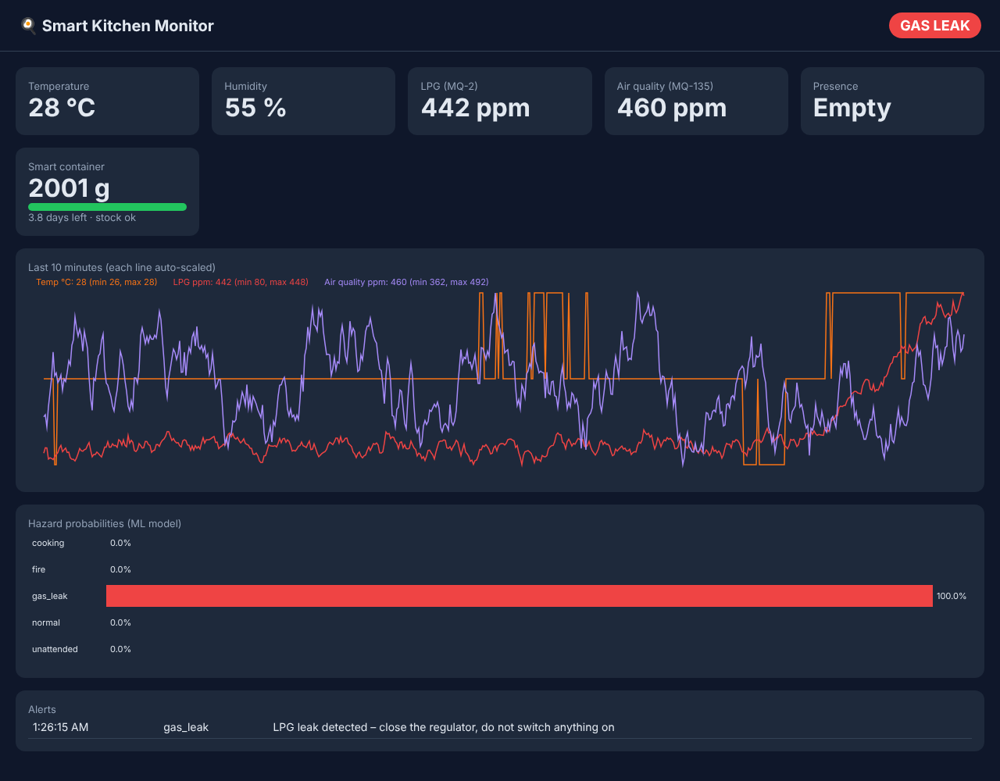

# IoT-Powered Smart Kitchen: Safety & Efficiency

An end-to-end smart-kitchen system that covers **Arduino Uno + ESP8266 firmware**, a **cloud backend with an ML hazard detector**, and a **live dashboard**. It catches LPG leaks, fire and smoke, and *unattended cooking*, runs the exhaust fan automatically, and tracks a smart container so supplies can be reordered before they run out.

Reference implementation of the paper **"IoT-Powered Smart Kitchen Systems for Enhanced Efficiency and Safety"** by V. Gaikwad, P. Sahani, S. Khan, R. Sakpal, **S. Punde**, N. Shinde (Vishwakarma Institute of Technology, Pune).


*Replayed gas leak: the ML model raised the alarm at **442 ppm**. The fixed firmware threshold would only have fired at 1,000 ppm, more than 3 minutes later.*

## The problem

Cooking is the leading cause of home fires, and LPG leaks are a daily risk in Indian kitchens. Single-threshold alarms fire late, because LPG has to reach 1,000+ ppm before they trigger. They also fire falsely when a burner puffs during ignition, and they can't tell "someone is cooking" apart from "the stove has been on for 20 minutes with nobody home".

## Architecture

```
 DHT11 ─┐                                            ┌─► SQLite (telemetry, alerts)
 MQ-2  ─┤   Arduino Uno          ESP8266            │
 MQ-135─┼─► local safety rules ─► Wi-Fi gateway ─────┼─► FastAPI backend ─► ML hazard detector
 PIR   ─┤   (buzzer, LED, fan)    (JSON over HTTP)   │     (HistGradientBoosting on 30 rolling features)
 Flame ─┤   works even offline                       ├─► alerts (Telegram) + FAN:1 command back to the Uno
 HX711 ─┘                                            └─► live dashboard (no external JS, works on LAN)
```

* **Two layers of safety.** The Uno's fixed rules sound the buzzer and start the fan **immediately and offline**, for example on a flame or LPG above 2,000 ppm. The cloud model adds **earlier and smarter** detection.
* **Hazard classes:** `normal`, `cooking`, `gas_leak`, `fire`, `unattended` (stove heat with no motion for 5 or more minutes).
* **Features (causal, past-only):** rolling means and slopes over 30 s and 120 s, temperature above the slow room baseline, LPG above baseline, motion counts, seconds since last motion, and flame hits.
* **Smart container.** A load cell tracks the level. A linear trend gives usage per day and days left, and the system raises a reorder flag below 20% (the paper's automatic-booking idea).

## Results

The labelled dataset is 120 hours at 1 Hz (432,000 readings, 288 episodes). Train and test are split **by episode**, so no event leaks across the split.

| | ML detector (10 s confirmation) | Fixed thresholds (firmware rules) |
|---|---|---|
| Macro F1 (5 classes) | **0.988** | 0.541 |
| Gas-leak detection delay (median) | **14 s** | 213 s |
| Fire detection delay (median) | 9 s | 0 s (flame sensor) |
| Unattended cooking: detected | **15 / 15** | 6 / 15 |
| False alarms per day | **4.7** | 26.0 |

**Confirmation window trade-off.** Requiring N agreeing seconds before alerting trades speed for fewer false alarms:

| Confirm | Gas-leak delay | Fire delay | False alarms/day |
|---|---|---|---|
| 3 s | 6.5 s | 2 s | 15.8 |
| 5 s | 9 s | 4 s | 10.2 |
| **10 s (default)** | 14 s | 9 s | **4.7** |

Fire still triggers the local buzzer instantly through the flame-sensor rule on the Uno, so the cloud model can afford a 10-second confirmation.

> **About the data:** physical sensors weren't available in this environment, so `data/kitchen_sensor_dataset.csv.gz` comes from a physics-inspired simulator (`kitchen/simulator.py`). It models first-order thermal and gas dynamics, MQ-sensor humidity drift, DHT11 1 °C quantisation, PIR dropouts and false triggers, and flame-sensor misses. The firmware emits exactly the same JSON schema, so the pipeline runs unchanged on real hardware. Retrain on real recordings before relying on it for safety.

## Hardware (bill of materials, about ₹1,800)

| Part | Pin (Uno) |
|---|---|
| DHT11 temperature/humidity | D2 |
| HC-SR501 PIR | D3 |
| IR flame sensor | D4 |
| HX711 + 5 kg load cell | D5 (DOUT), D6 (SCK) |
| Buzzer / red LED / green LED | D7 / D8 / D9 |
| 5 V relay → exhaust fan | D10 |
| ESP8266 (SoftwareSerial, 3.3 V divider on TX) | D11 (RX), D12 (TX) |
| MQ-2 (LPG/smoke) | A0 |
| MQ-135 (air quality) | A1 |

Flash `firmware/arduino_uno_controller/` to the Uno and `firmware/esp8266_gateway/` to the ESP8266. Set the Wi-Fi credentials, `API_URL` and `API_KEY` in the gateway sketch.

## Run the software

```bash
pip install -r requirements.txt
python -m kitchen.simulator --hours 120          # regenerate dataset (included already)
python -m kitchen.train_detector                 # -> models/hazard_detector.joblib, results/detector_report.json
uvicorn kitchen.api:app --host 0.0.0.0 --port 8000   # dashboard at http://<pc-ip>:8000
python -m kitchen.simulator --stream http://127.0.0.1:8000/api/telemetry --speed 20   # no hardware? stream simulated data
pytest -q
```

Optional push alerts: set `TELEGRAM_TOKEN` and `TELEGRAM_CHAT_ID`. For production, change `KITCHEN_API_KEY`.

## API

| Endpoint | Purpose |
|---|---|
| `POST /api/telemetry` | device pushes a reading (`X-Api-Key`, `X-Device-Id` headers); response carries `FAN:1/0` commands |
| `GET /api/latest` | current state + class probabilities |
| `GET /api/history?minutes=10` | recent readings |
| `GET /api/alerts` | alert log |
| `GET /api/inventory` | container level, usage/day, days left, reorder flag |

## Structure

```
firmware/arduino_uno_controller/   sensors + local safety logic (C++)
firmware/esp8266_gateway/          Wi-Fi → HTTP bridge (C++)
kitchen/simulator.py               labelled sensor simulator + live streamer
kitchen/features.py                causal rolling features + rule baseline
kitchen/train_detector.py          training, latency & false-alarm evaluation
kitchen/api.py                     FastAPI backend, alerting, inventory
kitchen/static/dashboard.html      live dashboard
```
